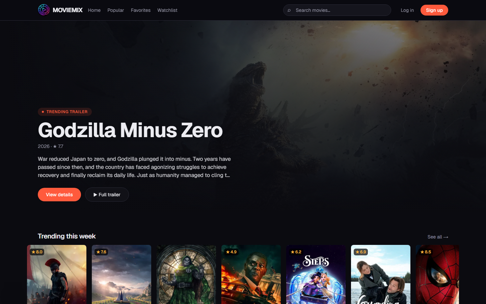

# MOVIEMIX

A full-stack movie discovery app: browse trending, popular and upcoming movies, search, watch trailers, and keep your own favorites and watchlist.



- **Frontend:** Next.js 16, React 19, TypeScript, Tailwind CSS
- **Backend:** FastAPI, SQLAlchemy, PostgreSQL
- **Data:** [TMDB API](https://www.themoviedb.org/documentation/api)

## Features

- Home page with a random trailer hero that pauses when you scroll away
- Movie lists (trending, popular, top rated, upcoming) with pagination
- Search and movie details (cast, genres, trailer)
- Sign up / log in with email and password (JWT), or **Continue with Google**
- Personal favorites and watchlist

## Project structure

```
movie-app/
├── backend/    FastAPI API (auth, movies proxy to TMDB, favorites/watchlist)
└── frontend/   Next.js app
```

## Getting started

### Requirements

- Python 3.12+
- Node.js 20+
- PostgreSQL
- A TMDB API key

### 1. Database

Create an empty PostgreSQL database (tables are created automatically on first start):

```sql
CREATE DATABASE movie_app;
```

### 2. Backend

```bash
cd backend
python -m venv venv
# Windows: venv\Scripts\activate    macOS/Linux: source venv/bin/activate
pip install -r requirements.txt
cp .env.example .env    # then fill in the values
uvicorn app.main:app --reload
```

The API runs on http://127.0.0.1:8000 (docs at `/docs`).

### 3. Frontend

```bash
cd frontend
npm install
cp .env.example .env.local    # then fill in the values
npm run dev
```

The site runs on http://localhost:3000.

### Google sign-in (optional)

1. In Google Cloud Console, create an **OAuth client ID** (type: Web application).
2. Add `http://localhost:3000` and `http://localhost` to **Authorized JavaScript origins**.
3. Put the Client ID in `backend/.env` (`GOOGLE_CLIENT_ID`) and `frontend/.env.local` (`NEXT_PUBLIC_GOOGLE_CLIENT_ID`).
4. Restart both servers.

If the Client ID is empty, the Google button is hidden.

## Credits

Movie data and images from [TMDB](https://www.themoviedb.org). This product uses the TMDB API but is not endorsed or certified by TMDB.
